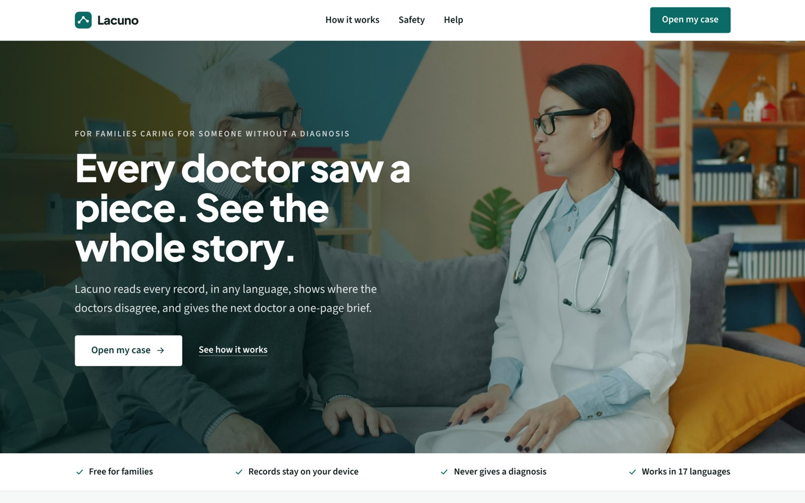
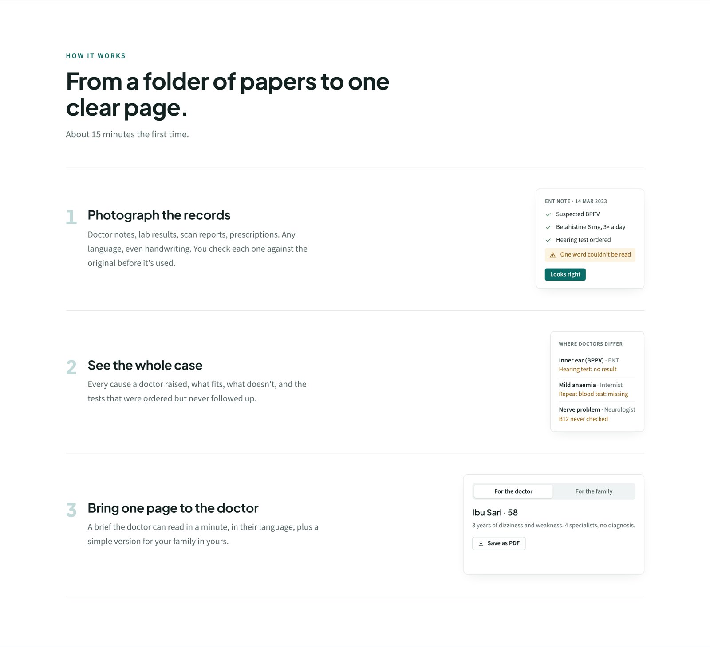
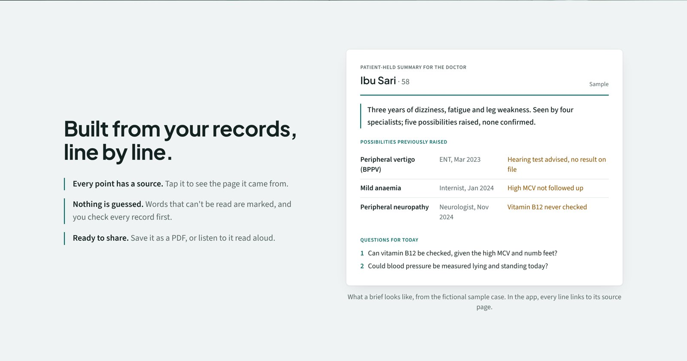
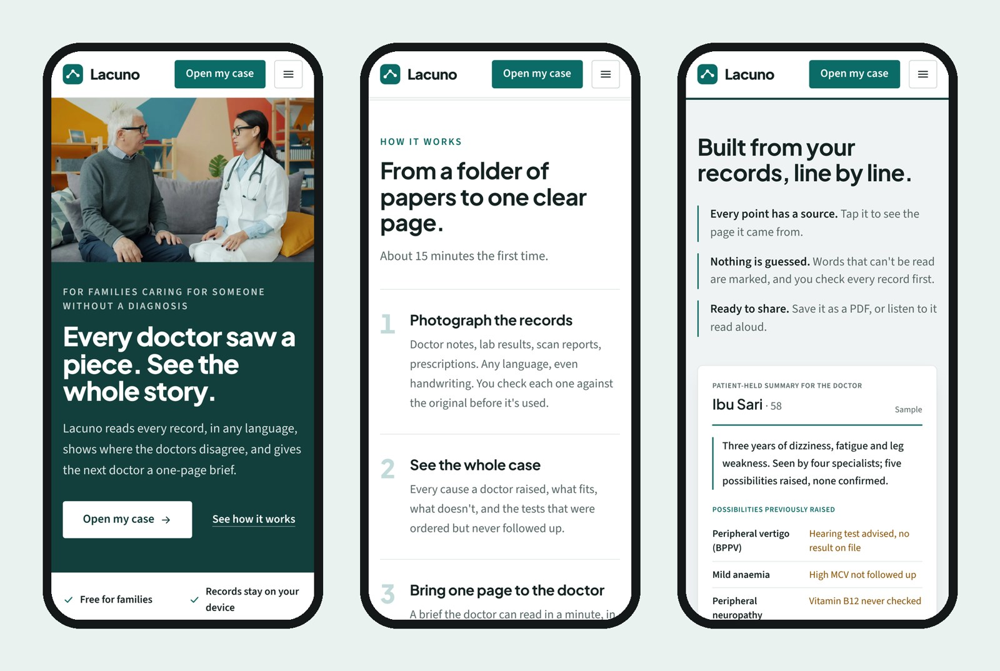
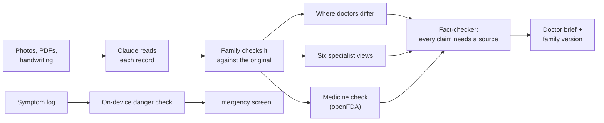

# Lacuno

**Every doctor saw a piece. Lacuno shows the whole story.**

Lacuno helps families caring for someone who has seen many doctors without getting a diagnosis. Upload every record, in any language, and see where the doctors disagree, what nobody followed up, and a one-page brief the next doctor can read in a minute.

🌐 **[lacuno.health](https://lacuno.health)** · Built at Cal Hacks 13.0



## Why

My mum has had dizziness, fatigue and weakness for years. Each specialist looked at one part of it, and none of them saw the whole picture. My family carries folders of notes between clinics, in Indonesian, and does the coordinating ourselves. Lacuno is the tool we wanted.

The name comes from *lacuna*, Latin for "gap".

## What it does



- **Read any record.** Photos, PDFs or handwriting, in any language. Claude pulls out the doctor, the date, the results and the medicines, and quotes the original text. Anything it can't read is flagged, never guessed. The family checks each record next to the original before it's used.
- **Where doctors differ.** Every cause a doctor raised, what fits, what doesn't, and the tests that were ordered but never followed up.
- **Six specialists.** Ear, nerves, heart, hormones, bones and a pharmacist each review the whole case and suggest what to check and what to ask.
- **Medicine check.** Each medicine is looked up in the FDA drug label database. Side effects and combinations that match the symptoms become questions for the doctor.
- **Doctor brief.** One page in the doctor's language, plus a plain version for the family in theirs. Save it as a PDF or listen to it.
- **Symptom log.** Say or type what happened. Warning signs open an emergency screen with the local emergency number, even offline.
- **Also:** several cases per account, your phone as a camera via QR code, Apple Health and Google Fit import, visit reminders on your phone, and hospitals nearby.





## Safety

Medical AI has to be careful, so this was designed in from the start.

- **Never a diagnosis.** Lacuno never names or ranks a cause. It organises what real doctors wrote and turns gaps into questions.
- **Every point has a source.** Each finding cites the records it came from, and anything without a source is removed.
- **Fact-checked.** A second Claude pass checks every analysis against the records before it's shown.
- **Records are data, not instructions.** Text inside an uploaded record can't change what the AI does.
- **Emergencies first.** Warning signs are checked instantly on the device, then again by Claude.
- **Private.** Records stay on the device. Our server stores nothing.

We stress-tested this with a planted record telling the AI to ignore its rules and invent a diagnosis. Every output ignored it. All 14 emergency descriptions, in 11 languages, were caught, with no false alarms (`npm run safety-test`).

## How we built it



Claude Opus 5.5 does the reading and reasoning through the Anthropic API. Every call uses structured outputs, so answers always come back in a fixed shape with source IDs, and every call shares one safety prompt (`src/lib/claude.ts`). We built Lacuno with Claude Code.

| Service | What it does in Lacuno |
|---|---|
| **Anthropic Claude API** | Reads records, compares doctors, specialist views, fact-checking, the brief |
| **openFDA** | Drug labels for the medicine check |
| **OpenStreetMap** | Hospitals and clinics near you |
| **ElevenLabs** | Reads the brief aloud |
| **Auth0** | Sign-in |
| **IndexedDB** | Keeps records on the device |
| **Web Push + Upstash** | Visit reminders on your phone |
| **PeerJS** | Uses your phone as a camera for your laptop |

Next.js 15, React 19, TypeScript and Tailwind, deployed on Vercel.

```
src/app/api/   extract, map, lens, brief, medcheck, episode, speak, push
src/lib/       claude.ts (safety rules), schemas.ts, verify.ts (fact-checker),
               medcheck.ts, danger.ts (on-device emergency check)
```

## Try it

On [lacuno.health](https://lacuno.health), open the built-in **Ibu Sari** sample case, or upload the five scanned records in [`samples/bapak-hasan`](samples/bapak-hasan). Both are fictional and written in Indonesian.

To run it yourself:

```bash
npm install
cp .env.example .env.local   # add your ANTHROPIC_API_KEY; everything else is optional
npm run dev
```
